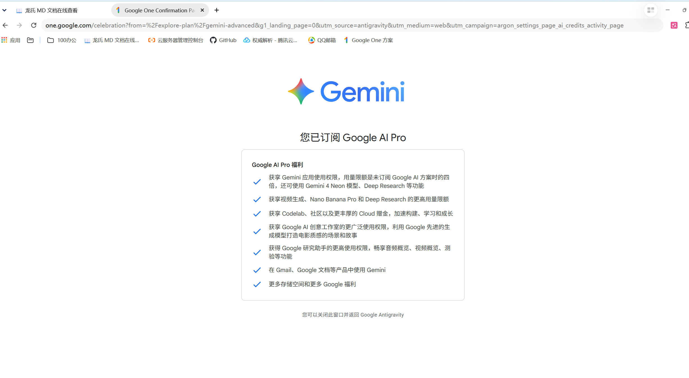
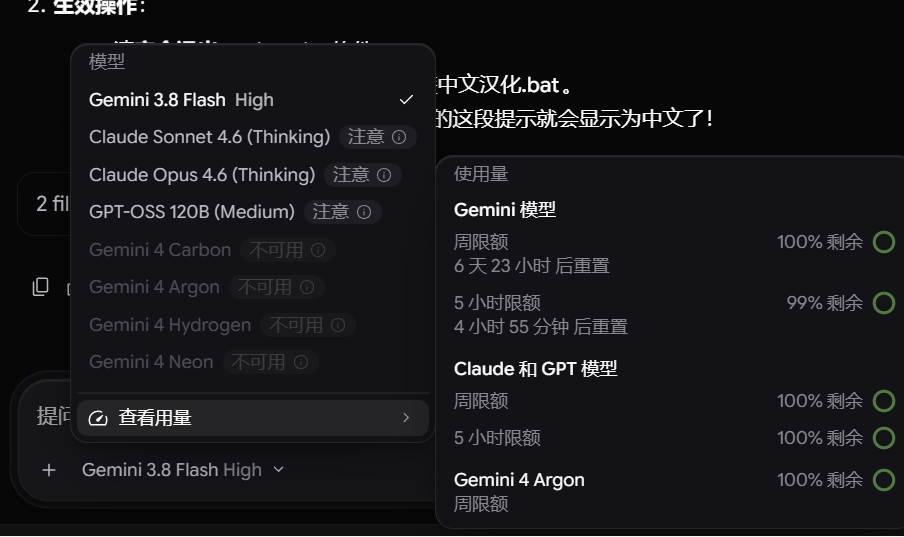
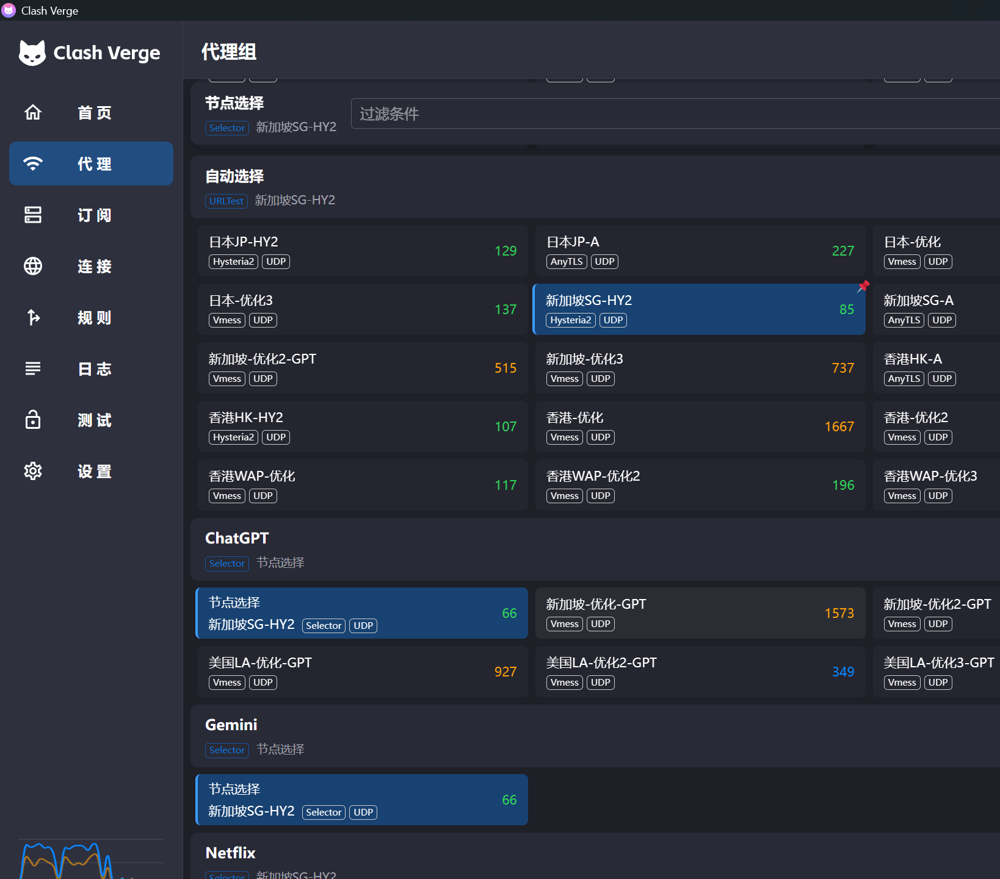

# Antigravity 代理接入完全指南

> **一句话**：Google Antigravity（VSCode fork AI IDE）连不上 Code Assist？不是 Clash 的问题，是 **VSCode 内核不理会系统代理**——给应用单独指路，两分钟解决，系统代理一行不动。
>
> 本仓库 = 完整实战记录（含截图）+ 可直接执行的 `SKILL.md`。适用于一切 VSCode 内核 fork 应用（Antigravity / Code / Cursor 类）"系统代理开着却连不上外网"的场景。

---

## 一、问题现场与错误码速诊

Antigravity 直连 Google Code Assist 报错：

```
dial tcp 172.217.114.4:443: connectex: A connection attempt failed
```

被墙 IP 裸连超时。此时系统代理（Clash）明明开着——**为什么没用？** 看下面原理。

**三种错误码，三个不同根因**（先对号入座）：

| 错误码 | 根因 | 修法 |
|---|---|---|
| `dial tcp ... timeout` | 域名被墙裸连（系统代理管不到 Electron） | → 第四节方案 A |
| `403 LOCATION_NOT_ELIGIBLE` | 某个 googleapis 子域名**掉进直连规则**，CN 出口被拒 | Clash 分流补该域名 |
| `400 User location is not supported` | ①AI 扩展的 **Node 内置 fetch（undici）天生无视系统代理+环境变量**；②代理节点在受限区 | `http.proxySupport: "on"` + 换节点 |

**判定技巧**：同一代理出口 IP 下，**网页 200 而 agent API 400** = 不是 IP 的问题，是请求没走代理（网络栈差异）。

## 二、核心原理（30 秒看懂）

| 层级 | 能否覆盖 VSCode 内核 | 说明 |
|---|---|---|
| 系统代理（WinINET） | ❌ | Electron/Node 网络栈不理会系统代理设置，部分组件直接 `dial tcp` 裸连 |
| TUN 模式（虚拟网卡） | ✅ 但坑多 | 接管一切流量应用无感——但火绒拦驱动、IPv6 绕过、自启失败三坑 |
| **应用内 `http.proxy`** | ✅ 精准 | VSCode 内核原生遵守，只让这一个应用走代理，全局零影响 |

**结论**：`settings.json` 加一行代理 = 手术刀方案。

## 三、探测流程（动手前 1 分钟，全部只读）

```bat
:: ① 代理软件实际监听端口（Clash Verge 默认 7897，以实测为准）
netstat -ano | findstr "LISTENING" | findstr ":7897 :7890"

:: ② 定位应用配置目录
dir "%APPDATA%" | findstr /i "antigravity"

:: ③ 验证代理端口可出网 + 出口国家
curl -x http://127.0.0.1:7897 -I https://www.google.com --max-time 8
curl -x http://127.0.0.1:7897 https://api.country.is/
```

## 四、修复落地

`%APPDATA%\Antigravity\User\settings.json`（不存在就新建）：

```json
{
  "http.proxy": "http://127.0.0.1:7897",
  "http.proxySupport": "on"
}
```

**为什么必须 `proxySupport: "on"`**：AI 扩展用的是 **Node 内置 fetch（undici）——它天生无视系统代理，也无视 HTTP_PROXY 环境变量**。只有 VSCode 的强制代理模式能把它按进代理。只设 `http.proxy` 而不开 "on" = 渲染端走代理但 AI 扩展仍直连。

完整细节（应用内 UI 路径、合并启动脚本、JSON 语法注意）见 [SKILL.md](SKILL.md)。

## 五、额度闭环：Google AI Pro 学割订阅

代理通了只是进门，**免费额度抠搜**才是痛点。日本区学生割：

- **JP¥720/月**（75% off，原价 ¥2,900）≈ **30 元人民币/月**，最长锁定 **4 年**（申请截止 2026-12-31）
- 学生认证通过后直接锁价，订阅成功确认页：



福利：Gemini 应用 **4 倍用量限额**、Gemini 4 Neon 模型、Deep Research、视频生成 / Nano Banana Pro 更高额度、Cloud 赠金、Gmail/文档集成、更大存储。

## 六、模型解锁与满血用量

订阅生效后**重启应用**（plan 权限启动时拉取），模型列表解锁：



- **Gemini 3.8 Flash (High)** / **Claude Sonnet 4.6 (Thinking)** / **Claude Opus 4.6 (Thinking)** / **GPT-OSS 120B** 直接可用
- Gemini 4 系列（Carbon/Argon/Hydrogen/Neon）首次显示"不可用"→ **重启即解锁**（plan 权限缓存）
- 用量面板：周限额 100%、5 小时限额 99%——满血

**模型档位速查**（Google 用化学元素命名）：

| 元素 | 定位 |
|---|---|
| Carbon 碳 | 顶配：长期大项目 |
| Neon 氖 | 甜点位：日常深度工作 |
| Hydrogen 氢 | 快枪手：快速执行 / agent 工作流 |
| Argon 氩 | 上一代老兵 |

**实战提示**：Claude 系模型走 Anthropic 路由、**不受谷歌账号区域风控影响**——Gemini 4 报 400 时切 Claude 干活零损失。

## 七、出口固定：url-test 自动组是隐形杀手（实战案例）

一切配置正确（settings.json 代理、账号 JP、订阅生效），Gemini 检测却在 **CHN(不支持) 与 SGP(支持) 之间乱跳**，agent 执行随机报 400。

**根因**：订阅组结构 `Gemini → 节点选择 → 自动选择(url-test)`——每 600 秒测速自动切换，节点池含香港×9（Gemini 不支持区，显示 CHN）。

**修法**：「节点选择」手动固定为支持区最优节点（实测 SG-HY2 延迟 85ms 全场最低），Gemini 组跟随固定，IPv6 关闭双保险：



固定后连刷五次检测必须恒定 SGP/JP——之后 agent 执行的 400 彻底消失。

## 八、坑清单（每个都咬过人）

| 坑 | 症状 | 规避 |
|---|---|---|
| 系统代理陷阱 | 系统代理开着 Electron 仍直连 | 应用内显式配置 |
| **undici fetch 陷阱** | 环境变量+系统代理全设了，AI 扩展仍直连 | `proxySupport: "on"` |
| **Go gRPC 陷阱** | 部分 gRPC 调用不读 HTTP_PROXY | 关键域名走 Clash 分流兜底 |
| 第三方启动入口 | 汉化包 bat 等不带代理变量，400 复发 | 合并启动脚本统一注入 |
| TUN 坑① | 杀软拦 TUN 驱动，静默失效 | 加白名单或不用 TUN |
| TUN 坑② | IPv6 绕过 TUN 直连 | 关 IPv6 或 TUN 接管 IPv6 |
| TUN 坑③ | TUN 自启失败，重启即失效 | 设自启并验证 |
| 端口抄默认 | 教程 7890 实际 7897 | netstat 实测 |
| proxy 缺协议头 | `127.0.0.1:7897` 不生效 | 必须带 `http://` |
| JSON 改坏 | settings.json 语法错 → 设置全灭 | 改前备份 |
| cmd 脚本编码 | LF/UTF-8/中文注释 → cmd 拆错行乱码 | CRLF + 无 BOM + 纯 ASCII |
| 中文路径进 cmd | Git Bash 调中文 bat 报错 | PowerShell `Start-Process -FilePath` |
| 订阅后模型不可用 | plan 权限缓存旧 | 重启应用 |

## 九、更新存活表（应用自动更新后逐项核对）

| 项 | 更新后 | 依据 |
|---|---|---|
| settings.json（http.proxy） | ✅ 存活 + 启动自愈 | 用户配置目录独立于安装目录；启动脚本自动检测恢复 |
| 启动脚本 / VBS / 自愈 js | ✅ 存活 | 自建目录（AntigravityLauncher）更新器不认识、永不被覆盖 |
| 汉化 | ✅ 自动重注入 | ensure_localized --fix 每次启动跑 |
| 代理环境变量 | ✅ | 启动脚本每次注入 |
| 快捷方式 | ⚠️ 会被重置回裸 exe | 已知行为：**首次裸点中招一次 → 再点一次快捷方式自愈** |
| 订阅 / 云端模型 | ✅ | 账号级 |

## 十、汉化包启动（中文界面）

Antigravity 官方自动更新会冲掉汉化——用汉化包的启动入口（自动检查/重注入汉化再启动）：

```
D:\...\antigravity2-cn-main\启动Antigravity(自动检查汉化).bat
```

内部执行 `node scripts/ensure_localized.js --fix --launch`。**注意**：重注入需应用先关闭（文件占用）；该入口**不带代理变量**，生产环境请用第四节合并启动脚本。

## 十一、一页速查

```
症状：VSCode 内核应用连不上被墙域名 / 400 location not supported
  → netstat 确认代理端口 → curl api.country.is 验出口国家
  → settings.json: {"http.proxy":"http://127.0.0.1:PORT","http.proxySupport":"on"}
  → 合并启动脚本(代理env+汉化+启动) → 重启 → 验证
  → 403=分流补域名(Merge.yaml) / 400=proxySupport on+换节点 / 订阅锁额度
  → 更新后失效 = 快捷方式重置(点两次自愈) + 配置自愈兜底
  → 不选 TUN（三坑），不改系统代理（伤全局）
```

---

**适用范围**：任何 Electron/VSCode 内核应用（Antigravity、Code、Windsurf、Kiro…）+ 任意代理软件（Clash Verge / Mihomo / CFW / v2rayN），原理相通，端口与路径按实际替换。

**License**: MIT
